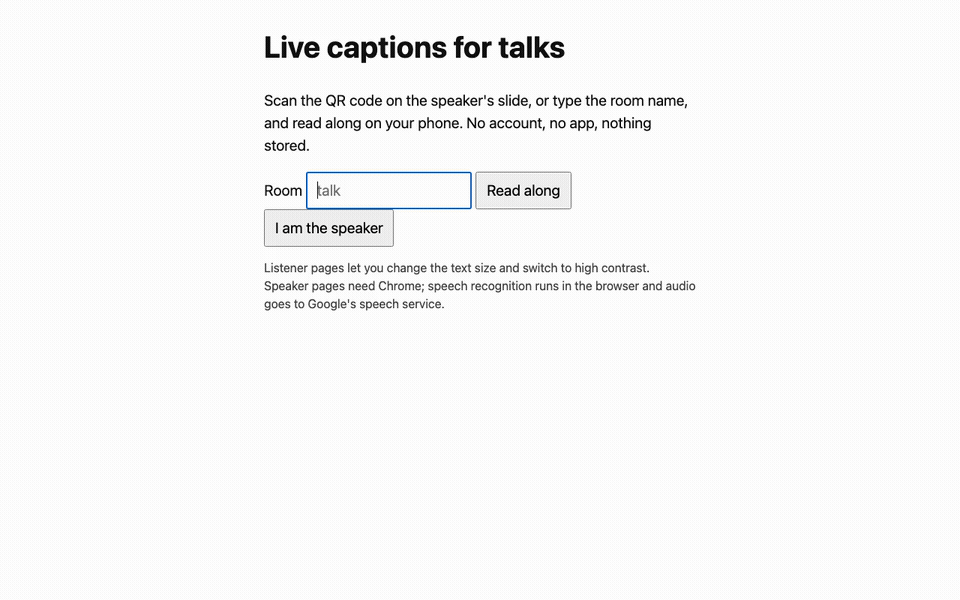
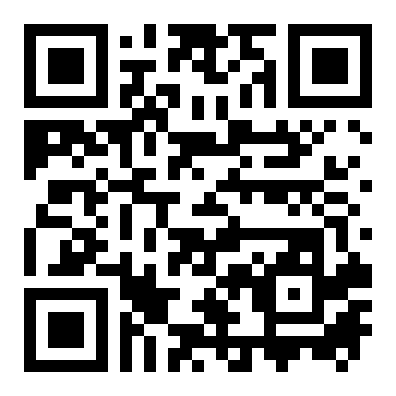
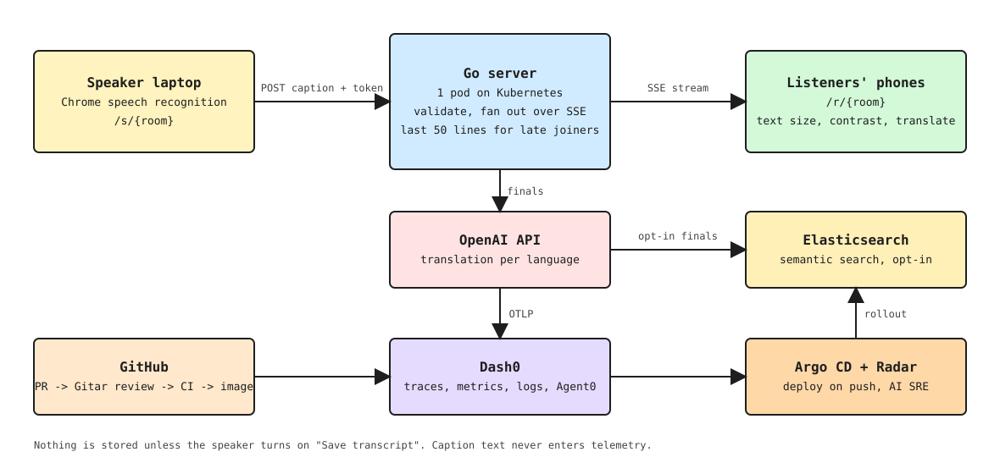

# Readalong

Live captions for any talk. Scan a QR code, read along on your phone. No app, no account, nothing stored.



Live: https://hack.cnh.radarhq.io

## Use it

1. Speaker: open `/s/<room>` in Chrome, paste the speaker token, press **Start captions**.
2. Listeners: scan the QR on the slide or open `/r/<room>` on any phone.
3. Captions appear as the speaker talks. **A+** for bigger text, **High contrast** to flip colors, pick a language to read translated lines, **Share** to pass the link on.

QR for a room: `qrencode -o qr.png https://hack.cnh.radarhq.io/r/<room>`



## How it works



Editable source: [docs/architecture.excalidraw](docs/architecture.excalidraw).

- Speaker page: browser speech recognition, restarts itself when Chrome stops.
- Server: one Go binary, standard library. Validates room, text length and token. Keeps the last 50 lines for late joiners. Never blocks on a slow phone.
- Listener page: text size, high contrast, `aria-live`, pause scroll, "last caption N s ago" badge.
- Telemetry: OpenTelemetry traces, metrics and logs to Dash0. Only lengths and counts, never the text.
- Translation (optional): listeners pick a language; finished lines arrive translated through the OpenAI API, the live line stays in the original. Needs `OPENAI_API_KEY`; token usage and cost go to Dash0.
- Search (optional): if the speaker turns on "Save transcript", final lines go to Elasticsearch (`semantic_text`) and listeners get a search box that finds lines by meaning. Off by default; needs `ELASTIC_URL` and `ELASTIC_API_KEY`.

## Run locally

```sh
SPEAKER_TOKEN=$(openssl rand -hex 16) go run .
```

Speaker: http://localhost:8080/s/talk (Chrome). Listeners: http://localhost:8080/r/talk. Tests: `go test ./...`.

Optional Dash0 export: set `OTEL_EXPORTER_OTLP_ENDPOINT` and `OTEL_EXPORTER_OTLP_HEADERS`.

## Deploy

Push to `main` builds `ghcr.io/moezdil/hack:<sha>`; Argo CD deploys `deploy/` (see `argocd/application.yaml`). Create the Secret `hack` with `SPEAKER_TOKEN` and the OTLP variables first; it is never committed. One replica: fan-out is in memory.

## Privacy

No audio or accounts, ever. Transcripts are stored only if the speaker turns on "Save transcript" for their talk. Audio goes from the speaker's Chrome to Google's speech service.

## AI disclosure

Parts of this project were written with AI coding assistance and reviewed by the author.

## License

MIT
